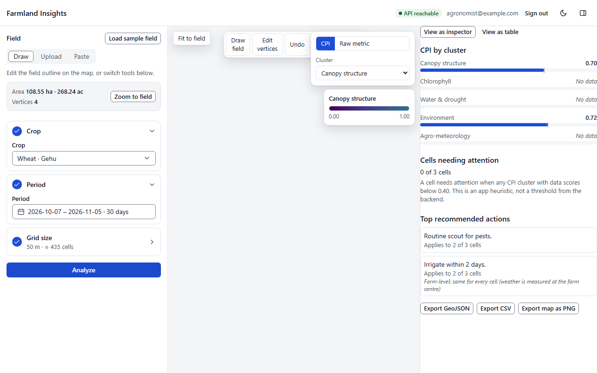

# Farmland Insights (frontend)

A desktop-first web app for the Farmland Insights API (the FastAPI backend in `../app`): outline
a farm on a map, pick a crop and a date range, run the analysis, and explore a grid of cells
showing crop health (CPI scores), raw metrics and recommended actions — then export the results
or reopen one of your last 10 runs.



More screenshots (dark theme, table view, narrow-window drawer, reduced motion, empty states) are
in [`docs/screenshots/`](docs/screenshots/).

## What it is

The full flow, end to end: sign in → draw, upload, paste or load a sample field → pick a crop and
period → set a grid size → analyze → explore the results on the map and in the inspector → export
GeoJSON, CSV or a PNG of the map → optionally reopen an earlier run from session history. See
[`../docs/FRONTEND_BUILD_PROMPT.md`](../docs/FRONTEND_BUILD_PROMPT.md) for the full spec this was built to,
and [`docs/PROGRESS.md`](docs/PROGRESS.md) for exactly what is built, what is unverified, and why.

## Quick start

Requirements: Node 22+ and pnpm (exact version pinned in `package.json`).

### Backend

From the **repository root** (not `frontend/`):

```sh
uv run uvicorn app.main:app --reload
```

This needs a populated `.env` at the repo root (PropelAuth and Earth Engine credentials — see the
backend's own docs). **Without one, the backend will not start at all** (this is expected and
documented: see `docs/DECISIONS.md` ADR-002). The frontend still works without a live backend for
everything except actually running an analysis: `pnpm dev` serves the app, the API health
indicator honestly shows "API unreachable" (the proxy answers 502), and every automated test uses
MSW or Playwright route interception instead of a real backend.

### Frontend

```sh
cd frontend
pnpm install
pnpm exec playwright install chromium   # only needed for `pnpm e2e`
copy .env.example .env                  # optional; defaults work (PowerShell: `copy`, bash: `cp`)
pnpm dev                                # http://localhost:5173
```

In development, `VITE_API_PROXY_TARGET` (default `http://127.0.0.1:8000`) tells the Vite dev
server where to proxy `/api` and `/health` — the backend has no CORS middleware
(`docs/BACKEND_REQUESTS.md` #3), so the browser never calls it directly; a proxy keeps everything
same-origin. In production, nginx plays the same role — see [Deployment](#deployment) below.

To actually sign in without a real PropelAuth account, set `VITE_ENABLE_DEV_TOKEN_LOGIN=true` in
your `.env` (the dev-token flow, spec §2.2 — never for a real deployment).

## Environment variables

All variables are read through `src/lib/env.ts`, which validates them with Zod at startup and
fails loudly, naming every invalid variable.

| Variable                       | Default                 | Purpose                                                                                  |
| ------------------------------ | ----------------------- | ---------------------------------------------------------------------------------------- |
| `VITE_API_PROXY_TARGET`        | `http://127.0.0.1:8000` | Dev/preview proxy target for `/api` and `/health` (`vite.config.ts` only; never bundled) |
| `VITE_ENABLE_DEV_TOKEN_LOGIN`  | `false`                 | Show the passwordless "Get token" sign-in (dev/testing only)                             |
| `VITE_TOKEN_TTL_MINUTES`       | `480`                   | Requested token lifetime, whole minutes > 0                                              |
| `VITE_MAP_STYLE_URL`           | unset                   | Optional custom vector style (absolute http(s) URL)                                      |
| `VITE_MAP_STYLE_SATELLITE_URL` | unset                   | Optional satellite style/tiles (absolute http(s) URL)                                    |
| `VITE_MAP_API_KEY`             | unset                   | Optional key for the map style                                                           |

Never commit `.env` files. `.env.example` is the only tracked one. See
[`docs/DEPLOYMENT.md`](docs/DEPLOYMENT.md) for which of these are build-time vs. runtime in a
Docker deployment (they are not the same thing).

## Scripts

| Script                           | What it does                                                            |
| -------------------------------- | ----------------------------------------------------------------------- |
| `pnpm dev` / `build` / `preview` | Vite dev server, production build, preview of `dist/`                   |
| `pnpm typecheck`                 | `tsc --noEmit` (strict, `noUncheckedIndexedAccess`, exact optionals)    |
| `pnpm lint` / `lint:fix`         | ESLint (typescript-eslint strict + stylistic type-checked, hooks, a11y) |
| `pnpm format` / `format:check`   | Prettier                                                                |
| `pnpm test` / `test:watch`       | Vitest (jsdom, Testing Library, MSW)                                    |
| `pnpm test:coverage`             | Vitest with v8 coverage; thresholds 70% global, 90% for `src/domain`    |
| `pnpm e2e`                       | Playwright (starts the dev server itself; Chromium)                     |
| `pnpm gen:api`                   | Regenerates `src/api/generated/openapi.d.ts` from `openapi.json`        |
| `pnpm check`                     | typecheck + lint + test + build (the quality gate)                      |
| `pnpm hooks:install`             | Opt in to the git pre-commit hook (see below)                           |

See [`docs/CONTRIBUTING.md`](docs/CONTRIBUTING.md) for commit style and how to add a metric or
crop.

### API types

`openapi.json` is the offline schema exported from the backend in Phase 0 (`app.openapi()`).
`pnpm gen:api` turns it into `src/api/generated/openapi.d.ts`, which is committed. Regenerate
both whenever the backend contract changes.

### Git hooks (opt-in)

The git repository root is the parent of `frontend/`, so Husky would have to set the repo-wide
`core.hooksPath`. To avoid changing anyone's git config as a side effect of `pnpm install`, there
is deliberately **no** `prepare` script. Opt in once with `pnpm hooks:install`; the pre-commit hook
(`.husky/pre-commit`) runs `lint-staged` inside `frontend/` for every commit.

## Architecture overview

```
src/
  app/          providers, router, layout shell (AppShell), workspace composition, error boundaries
  api/          http client, ApiError, endpoints, zod schemas, generated/openapi.d.ts
  domain/       pure TypeScript (no React, map or network imports; enforced by ESLint)
  features/
    auth/           session store, login, route guard, session-expiry toast
    field/          draw / upload / paste / sample field
    analysis-setup/ crop, period, grid steps, the analyze flow (useAnalysisFlow)
    map/            MapLibre wrapper, Terra Draw, grid layer, colour scales, legend, tooltip
    results/        inspector, farm summary, cell detail, table view, export
    history/        session history (last 10 runs, IndexedDB)
  components/ui/ design-system primitives (Button, Combobox, Dialog, Drawer, Toast, ...)
  hooks/        shared hooks
  lib/          env (zod-validated), logger (no-op in production), format, session storage
  styles/       tokens.css (CSS variables) and globals.css (Tailwind)
  test/         Vitest setup and the shared MSW server
tests/e2e/      Playwright specs (mocked backend, plus one E2E_LIVE=1-gated real-backend spec)
docker/         nginx config template for the production image
docs/           architecture, design, contract, decisions, progress, backend requests, deployment
```

Conventions: named exports only, no `any`, no non-null assertions, no `console.*` in `src` (use
`lib/logger`), feature folders talk to each other only through their `index.ts`. The `@/` alias
points at `src/`. Full detail, including the data-flow diagram and the state-ownership table (one
owner per kind of state, e.g. the auth token lives only in `src/lib/session`, never React state):
[`docs/ARCHITECTURE.md`](docs/ARCHITECTURE.md). Design tokens, primitives, the data colour scales
and their colour-blindness check, and the spec §3.6 review checklist:
[`docs/DESIGN.md`](docs/DESIGN.md).

## Testing

Strict TDD: write the failing test first, make it pass, then refactor. Unit and component tests
live next to the code as `*.test.ts(x)`. Network calls in tests go through the shared MSW server
(`src/test/msw`); a request with no handler fails the test. E2E specs in `tests/e2e` mock the
backend with `page.route` (`tests/e2e/fixtures/mock-api.ts`), so they run without credentials; one
spec (`happy-path.spec.ts`'s "live backend" describe block) is gated on `E2E_LIVE=1` and a real
running backend, and is skipped by default.

Real-browser-only coverage (jsdom cannot do these): MapLibre/Terra Draw rendering, PNG export, and
`IndexedDB` (session history — jsdom has none, so every unit test exercises an in-memory
fallback; `tests/e2e/history.spec.ts` reloads the page to prove a saved run survives in real
browser storage). See `docs/ARCHITECTURE.md` §6 for the full list of what each test layer does and
does not cover.

## Deployment

A production Dockerfile (multistage: `pnpm build`, then nginx — non-root, with a healthcheck,
proxying `/api` and `/health` to the backend) and a `docker-compose.frontend.yml` that adds the
frontend to the backend's own Compose project **without editing its `docker-compose.yml`**. Full
instructions, the CORS reasoning for why a reverse proxy is needed at all, and which env vars are
build-time vs. runtime: [`docs/DEPLOYMENT.md`](docs/DEPLOYMENT.md).

```sh
# from the repository root
docker compose -f docker-compose.yml -f frontend/docker-compose.frontend.yml up --build
```

A CI workflow (`pnpm check` + Playwright + a bundle-size budget) is included as
[`.github-workflows-example.yml`](.github-workflows-example.yml) rather than a live
`.github/workflows/` file — see that file's own comment for why.

## Known limitations

See [`docs/BACKEND_REQUESTS.md`](docs/BACKEND_REQUESTS.md) for the backend issues this frontend
works around rather than fixes (it never changes backend files): no CORS (worked around with the
reverse proxy above), a passwordless `/auth/token` (dev/testing only, gated behind
`VITE_ENABLE_DEV_TOKEN_LOGIN`), no crops endpoint (the frontend keeps its own mirror, checked
against the backend's list by `crops.drift.test.ts`), `precip`/`et_actual`/`gdd` on a scale that
doesn't match their advisory thresholds (shown with a caveat, ADR-006), and no way to tell "no
satellite data" apart from a real 0.0 CPI in a 200 response.

Frontend-side, honestly: no live-backend manual check has ever been run (`.env` is empty in every
environment this was built in, see ADR-002 and `docs/PROGRESS.md`'s open questions); the
10,000-cell hover-performance check and a Lighthouse report for `/login` are not done; Playwright
isn't wired into a live CI yet (see the workflow file above); and the production Docker image was
reviewed carefully but never actually built or run (no Docker daemon was available in the sandbox
this was built in — see `docs/DEPLOYMENT.md`'s last section).

## Roadmap

From `docs/PROGRESS.md`'s open questions (Q1-Q5) and carried-forward findings:

- Run the live-backend manual check and the `E2E_LIVE=1` E2E variant once real PropelAuth and
  Earth Engine credentials exist (Q1).
- Resolve whether `precip`/`et_actual`/`gdd`'s scaling (BACKEND_REQUESTS.md #4) is a known bug or
  intended, and update the unit/caveat accordingly (Q2).
- Settle on the production sign-in plan — hosted PropelAuth login vs. a real password endpoint —
  once the backend supports one (Q3).
- Pick a production basemap/satellite provider and key (Q4).
- Add the `lighthouse`/`@lhci/cli` devDependency and a real Lighthouse report for `/login`.
- Profile the 10,000-cell hover-performance check in a real browser with
  `tests/fixtures/large-analysis.ts`.
- Turn `.github-workflows-example.yml` into a real `.github/workflows/` file once the repo owner
  is ready for CI to run automatically.
- Owner review of the season-to-date date-preset heuristic (`docs/PROGRESS.md` Phase 5).
